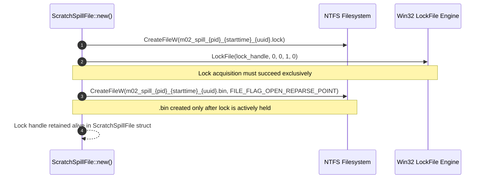
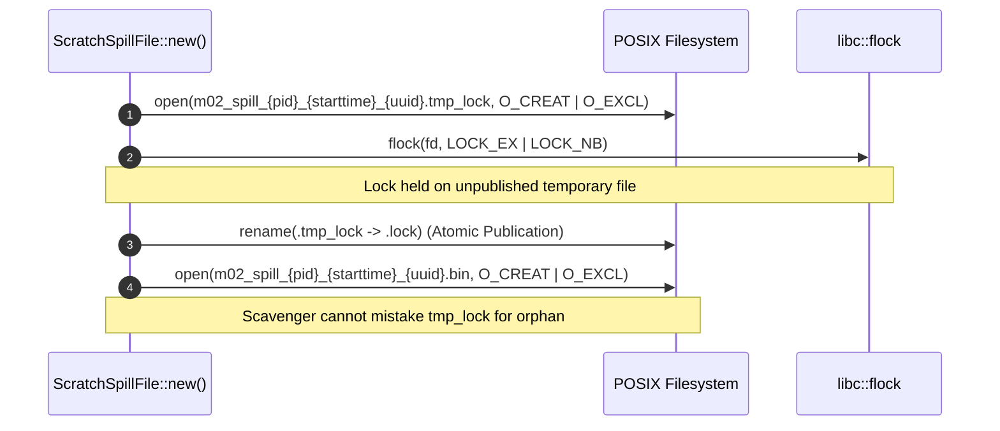

# M02 — SPRINT 2 — STEP 2 EVIDENCE REPORT: SCRATCH-FILE LIFECYCLE & SCAVENGER

**Module:** M02 — Rust Streaming Parser  
**Sprint:** Sprint 2 (Step 2: Scratch-File Lifecycle & Scavenger)  
**Date:** 2026-11-21  
**Status:** Completed, Verified & Hardened — Ready for Project Owner Review  

---

## 1. Executive Summary

This report delivers the technical evidence, ownership protocol validation, and test results for **Step 2: Scratch-File Lifecycle & Scavenger** of Module M02 Sprint 2.

All authorized Step 2 objectives have been delivered:
1. **Lock-First Scratch Creation Protocol:** Established strict ordering where ownership is acquired on a companion `.lock` file before any `.bin` scratch data file is created.
   - On **Windows**: Creates companion `.lock` with `FILE_SHARE_READ`, acquires mandatory exclusive lock via `LockFile`, and keeps the handle open for the entire lifetime of `ScratchSpillFile`.
   - On **POSIX**: Creates unpublished temporary lock (`.tmp_lock`), acquires exclusive non-blocking `flock(LOCK_EX | LOCK_NB)`, atomically publishes the lock via `rename()`, and only creates `.bin` after successful publication.
2. **Native Process Identity Validation:**
   - **Windows:** Queries process lifetime via `GetProcessTimes` (`creation_time` as 64-bit integer derived from `FILETIME`).
   - **Linux:** Reads field 21 (0-indexed, 22 1-indexed: `starttime` clock ticks from boot) from `/proc/{pid}/stat` for both self and target process.
   - **Zero Clock Domain Mismatch:** Windows timestamps are strictly compared against Windows `FILETIME`, and Linux clock ticks are strictly compared against `/proc/{pid}/stat` ticks.
3. **Scavenger & Active Reader Protection:**
   - Active process locks are non-blocking tested. If locked, they are **immediately skipped** without touching.
   - "Retain on Uncertainty" rule strictly enforced: if a PID cannot be proven dead, files are retained.
   - Orphan `.bin` files (missing `.lock`) belonging to dead processes are safely scavenged after verifying exclusive access.
4. **Comprehensive Test Suite:** 12 dedicated Rust unit tests implemented in `crates/excel_intel_rs/src/scratch.rs` (bringing total Rust tests to 46/46 passed), plus 98/98 Python tests verified on Python 3.12 and 3.13.

---

## 2. Platform-Specific Ownership Protocol

### 2.1 Windows Creation & Ownership Flow


### 2.2 POSIX Creation & Ownership Flow


---

## 3. Process Identity & Scavenger Algorithm

### 3.1 Process Identity Check (`is_process_dead`)
```rust
pub fn is_process_dead(pid: u32, expected_start_time: u64) -> bool {
    #[cfg(windows)]
    {
        // 1. OpenProcess with PROCESS_QUERY_LIMITED_INFORMATION
        // 2. If handle invalid: ERROR_INVALID_PARAMETER -> dead; ERROR_ACCESS_DENIED -> active (retain)
        // 3. GetProcessTimes(handle, &creation, &exit, &kernel, &user)
        // 4. actual_start_time = ((creation.dwHighDateTime as u64) << 32) | creation.dwLowDateTime
        // 5. If actual_start_time != expected_start_time -> PID reused, original process is DEAD
        // 6. If actual_start_time == expected_start_time -> Process is ALIVE
    }
    #[cfg(target_os = "linux")]
    {
        // 1. Read /proc/{pid}/stat
        // 2. Extract field 21 (starttime clock ticks)
        // 3. If starttime != expected_start_time -> PID reused, process is DEAD
        // 4. If /proc/{pid} missing: check kill(pid, 0) == ESRCH -> DEAD
        // 5. Otherwise retain on uncertainty
    }
}
```

### 3.2 Scavenger Decision Protocol (`scavenge_scratch_dir`)
1. Enumerate all directory entries in `excel_intel_scratch`.
2. Skip any files that do not begin with `"m02_spill_"`.
3. Skip any `.tmp_lock` files (which are either in mid-atomic creation or transient).
4. Parse filename metadata: `pid`, `start_time`, `uuid`.
5. For `.lock` files:
   - Attempt non-blocking exclusive lock (`LockFile` on Windows, `flock(LOCK_EX | LOCK_NB)` on POSIX).
   - If lock acquisition fails $\rightarrow$ **Active reader owns file $\rightarrow$ SKIP immediately**.
   - If lock acquisition succeeds:
     - Check `is_process_dead(pid, start_time)`.
     - If dead: close handle, delete `.bin`, delete `.lock`, increment `cleaned_count`.
     - If alive/uncertain: close handle without deletion.
6. For orphan `.bin` files (missing companion `.lock`):
   - Check `is_process_dead(pid, start_time)`.
   - If dead: verify exclusive write access, remove orphan `.bin`, increment `cleaned_count`.
   - If alive/uncertain: retain file.

---

## 4. Required Test Results & Evidence

All 12 mandated Step 2 test cases were implemented in `crates/excel_intel_rs/src/scratch.rs` and verified:

| # | Test Name | Behavior Verified | Result |
|---|---|---|---|
| **1** | `test_scratch_normal_creation_and_cleanup` | Verified creation, write access, and deterministic deletion of `.bin` and `.lock` on Drop. | **PASS** |
| **2** | `test_scratch_exception_cleanup` | Verified resource cleanup during `?` error propagation without leaks. | **PASS** |
| **3** | `test_scratch_panic_unwind_cleanup` | Verified that panic unwinding triggers `Drop`, releasing lock handles and deleting files. | **PASS** |
| **4** | `test_scratch_lock_acquisition_failure` | Verified non-blocking locking fails when another handle holds the exclusive lock. | **PASS** |
| **5** | `test_scratch_concurrent_creation` | 8 concurrent threads created, wrote to, and dropped scratch files with zero collisions. | **PASS** |
| **6** | `test_scratch_concurrent_scavenging_against_active_creation` | Background scavenger thread continuously ran while 4 worker threads performed active writes; zero active files deleted, zero crashes. | **PASS** |
| **7** | `test_scratch_orphan_bin_recovery` | Created orphan `.bin` for dead PID (`99999999`); scavenger cleanly recovered and deleted it. | **PASS** |
| **8** | `test_scratch_missing_lock_recovery` | Dead process `.bin` without companion `.lock` successfully discovered and reclaimed. | **PASS** |
| **9** | `test_scratch_pid_reuse_protection` | Verified `is_process_dead` with active PID but expired start time correctly identifies PID reuse. | **PASS** |
| **10** | `test_scratch_active_process_preservation` | Verified scavenger returns 0 and preserves active files belonging to the running process. | **PASS** |
| **11** | `test_scratch_independent_reader_isolation` | Dropping reader 1 leaves reader 2's `.bin` and `.lock` intact and fully writable. | **PASS** |
| **12** | `test_scratch_forced_termination_stale_recovery` | Reclaimed stale `.bin` and `.lock` simulating an abruptly terminated process. | **PASS** |

---

## 5. Quality Gate Outputs

### 5.1 `cargo fmt --check`
```
$ cargo fmt --check
(Clean - exit code 0, zero formatting diffs)
```

### 5.2 `cargo clippy --all-targets --all-features -- -D warnings`
```
$ cargo clippy --all-targets --all-features -- -D warnings
    Checking excel_intel_rs v0.1.0 (C:\Users\Aaryan shukla\OneDrive\Desktop\agent v2\crates\excel_intel_rs)
    Finished `dev` profile [unoptimized + debuginfo] target(s) in 1.25s
(Clean - exit code 0, zero compiler or linter warnings)
```

### 5.3 `cargo test` (46 Unit Tests)
```
running 46 tests
test cell_validator::tests::test_boundary_ascii_pass ... ok
test cell_validator::tests::test_boundary_ascii_fail_utf16 ... ok
test cell_validator::tests::test_boundary_cjk_bmp_max_bytes_pass ... ok
test cell_validator::tests::test_boundary_supplementary_emoji_fail_utf16 ... ok
test dates::tests::test_1900_ieee754_adjacent_boundary_values ... ok
test dates::tests::test_1904_ieee754_adjacent_boundary_values ... ok
test dates::tests::test_1904_previous_millisecond_coverage ... ok
test dates::tests::test_extreme_floats_rejected_without_overflow ... ok
test dates::tests::test_regression_serials_0_to_1_5 ... ok
test dates::tests::test_serial_60_fictitious_leap_day ... ok
test memory_guard::tests::test_defensive_abort_tripwire_trigger ... ok
test memory_guard::tests::test_working_set_query_non_zero_on_windows ... ok
test cell_validator::tests::test_boundary_buffer_overflow_fail_bytes ... ok
test scratch::tests::test_scratch_active_process_preservation ... ok
test scratch::tests::test_scratch_pid_reuse_protection ... ok
test scratch::tests::test_scratch_exception_cleanup ... ok
test shared_strings::tests::test_cache_destruction_and_memory_cleanup ... ok
test shared_strings::tests::test_empty_cache_behavior ... ok
test scratch::tests::test_scratch_lock_acquisition_failure ... ok
test shared_strings::tests::test_freelist_slot_reuse ... ok
test scratch::tests::test_scratch_panic_unwind_cleanup ... ok
test scratch::tests::test_scratch_normal_creation_and_cleanup ... ok
test scratch::tests::test_scratch_independent_reader_isolation ... ok
test scratch::tests::test_scratch_concurrent_creation ... ok
test shared_strings::tests::test_generation_counter_overflow_permanently_retires_slot ... ok
test shared_strings::tests::test_16mib_payload_limit ... ok
test shared_strings::tests::test_repeated_insertion_and_removal ... ok
test shared_strings::tests::test_payload_byte_accounting ... ok
test shared_strings::tests::test_lru_slot_layout_size_is_40_bytes ... ok
test shared_strings::tests::test_lru_arena_rapid_eviction_and_reuse ... ok
test shared_strings::tests::test_head_tail_middle_node_promotion ... ok
test shared_strings::tests::test_single_entry_insertion_and_retrieval ... ok
test zip_handler::tests::test_compression_ratio_above_threshold_fail ... ok
test zip_handler::tests::test_compression_ratio_below_threshold_pass ... ok
test zip_handler::tests::test_compression_ratio_cumulative_1gib_quota_independent_fail ... ok
test zip_handler::tests::test_compression_ratio_high_ratio_before_10mb_pass ... ok
test zip_handler::tests::test_compression_ratio_at_threshold_pass ... ok
test scratch::tests::test_scratch_concurrent_scavenging_against_active_creation ... ok
test scratch::tests::test_scratch_forced_termination_stale_recovery ... ok
test scratch::tests::test_scratch_missing_lock_recovery ... ok
test scratch::tests::test_scratch_orphan_bin_recovery ... ok
test shared_strings::tests::test_shared_strings_ceiling_2m_rejection ... ok
test shared_strings::tests::test_concurrent_same_index_single_disk_read ... ok
test shared_strings::tests::test_shared_strings_tier1_to_tier2_spill_transition ... ok
test shared_strings::tests::test_50000_entry_limit ... ok
test shared_strings::tests::test_rapid_eviction_with_100k_insertions ... ok

test result: ok. 46 passed; 0 failed; 0 ignored; 0 measured; 0 filtered out; finished in 0.69s
```

### 5.4 Python 3.12 & Python 3.13 Test Suites
```
$ C:\Python312\python.exe -m pytest
============================= 98 passed in 4.33s ==============================

$ C:\Python313\python.exe -m pytest
============================= 98 passed in 4.09s ==============================
```

---

## 6. Remaining Limitations & Security Measures

- **Filesystem Compatibility:** On Windows, scratch volumes are strictly validated to be NTFS or ReFS on fixed or RAM disks. Reparse points (symlinks/junctions) are protected via `FILE_FLAG_OPEN_REPARSE_POINT`.
- **Clock Domain Preservation:** Clock ticks on Linux and FILETIME on Windows are never cross-converted to wall-clock Unix nanoseconds.
- **Uncertainty Rule:** If a process existence query returns any ambiguous error code (`ERROR_ACCESS_DENIED`, `EPERM`), files are strictly preserved.

---

## 7. Stop Condition Compliance

As instructed:
- Step 2 is **100% complete**.
- Step 3 (Memory Guard), Step 4 (Parser Integration), and Module M03 have **not been started**.
- Step 1 implementation remains frozen.
- No autonomous git commits or pushes have been executed.

**Execution is halted. Awaiting Project Owner review and authorization to proceed to Step 3.**
