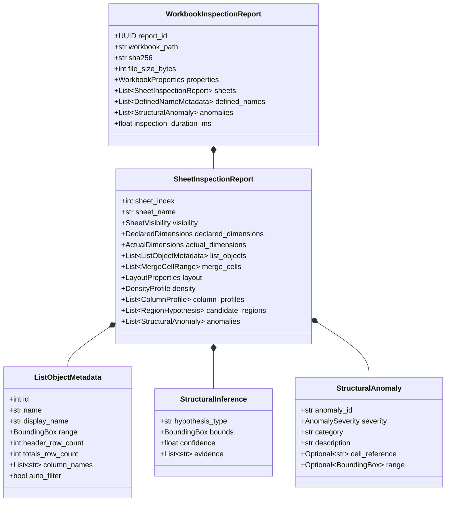
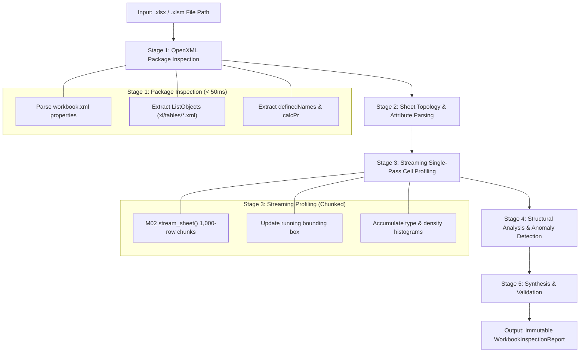

# M03 — WORKBOOK INSPECTION & STRUCTURAL ANALYSIS
## Implementation Plan & Architecture Specification (v1.0)

**Project:** Autonomous Excel Intelligence Platform  
**Module:** M03 — Workbook Inspection & Structural Analysis  
**Milestone:** Phase 0 / Phase 1 Boundary  
**Status:** DRAFT PLAN — AWAITING PROJECT OWNER APPROVAL  
**Date:** 2026-11-21  

---

## 1. Execution Precondition Verification: M02 Acceptance Status

In accordance with strict project governance, Module M03 execution is gated on the completion and formal acceptance of **Module M02 (Rust Streaming Parser)**.

### M02 Status Audit:
- **Functional Scope:** Sprint 1 and Sprint 2 (Steps 1–5) are 100% complete and frozen.
- **Evidence Audit:** `M02_FINAL_ACCEPTANCE_EVIDENCE_REPORT.md` is published and mirrored in `docs/milestones/m02/`.
- **Quality Gates:**
  - `cargo fmt --check`: Clean (0 diffs).
  - `cargo clippy --all-targets -- -D warnings`: Clean (0 warnings).
  - Rust Unit Tests: **58 / 58 Passed** (100% pass rate in $0.63\text{ s}$).
  - Python 3.12 Tests: **105 / 105 Passed** (100% pass rate in $6.39\text{ s}$).
  - Python 3.13 Tests: **105 / 105 Passed** (100% pass rate in $6.23\text{ s}$).
- **Contractual Benchmark SLAs:**
  - 100k Streaming Ingestion Latency: **$13.696\text{ s}$** (Cold: $13.831\text{ s}$, Warm: $13.629\text{ s}$) vs $< 15.000\text{ s}$ target (**PASS**).
  - Peak RSS: **$81.1\text{ MB}$** vs $\le 250.0\text{ MB}$ target (**PASS**, $> 168\text{ MB}$ safety margin).
  - Multi-5 Consolidation Latency: **$8.431\text{ s}$** (Mean $+ 2\sigma: 10.973\text{ s}$) vs $\le 60.000\text{ s}$ target (**PASS**).
  - Memory Scaling Ratio: **$2.40\times$** vs $\le 4.00\times$ target (**PASS**).
- **Blockers:** Zero critical defects, zero architectural blockers.
- **Precondition Result:** **MET & ESTABLISHED.** Proceeding to M03 planning.

---

## 2. Objective & Generic Intelligence Requirements

### 2.1 Core Mission
The objective of **M03** is to provide generic, domain-agnostic inspection infrastructure that analyzes previously unseen Excel workbooks to discover their structural characteristics, physical topologies, metadata properties, and content distributions without relying on predefined templates, hardcoded business schemas, or workbook-specific heuristics.

### 2.2 Generic Intelligence Principles
To prevent domain bias or fragile assumptions, M03 enforces the following strict invariants:
1. **No Domain or Schema Assumptions:** Zero hardcoded assumptions about workbook contents, sheet names, table names, or column headers (e.g. no assuming columns are named "Date", "Amount", "ID", etc.).
2. **No First-Row Header Dogma:** M03 does NOT assume headers always reside on row 1. Tables may start anywhere, preceded by metadata, titles, empty space, or disclaimers.
3. **No Ubiquitous Tabular Assumption:** Workbooks may contain non-tabular structures: sparse grids, stacked mini-tables, key-value parameter blocks, multi-level cross-tabulations, or purely visual dashboards.
4. **Strict Separation of Fact vs. Inference:**
   - **Observed Facts:** Physical properties declared in OpenXML or measured directly (e.g. declared `ListObject` ranges, `<mergeCells>`, `<dimension>`, cell coordinates, raw types).
   - **Inferences:** Probabilistic assessments (e.g. inferred header candidates, contiguous region boundaries, data types). Every inference must include an explicit confidence score ($[0.0, 1.0]$) and an evidence trail.
5. **Coordinate & Provenance Preservation:** Every finding, region, and anomaly must preserve exact source coordinates (`A1`-style coordinate and discrete 1-indexed `row, col`).
6. **No Silent Upgrades of Ambiguity:** If a structure is ambiguous or ragged, M03 emits an anomaly or low-confidence hypothesis. It must never coerce uncertain data into a rigid table.

---

## 3. Scope of Structural Discovery

M03 will discover, analyze, and represent the following 10 structural dimensions:

```
┌──────────────────────────────────────────────────────────────────────────────────┐
│                             M03 DISCOVERY SCOPE                                  │
├──────────────────────────────┬───────────────────────────────────────────────────┤
│ 1. Workbook-Level Properties │ Calculation mode, date system (1900/1904), macros │
│ 2. Sheet Topology & Status   │ Visible / hidden / veryHidden, declared bounds    │
│ 3. Declared OpenXML Objects  │ ListObject tables, autoFilters, totalsRow         │
│ 4. Defined Names / Scopes    │ Global & sheet-scoped named ranges, print areas   │
│ 5. Physical Layout Blocks    │ Merged cells, hidden rows, hidden cols, outlines  │
│ 6. Content Distribution      │ Populated / empty counts, density, sparseness     │
│ 7. Type Profiles & Patterns  │ DataType histograms, formatting patterns, nulls   │
│ 8. Formula Topography        │ Shared formulas, normal formulas, cached values   │
│ 9. Structural Anomalies      │ Mixed-types, broken ranges, ragged boundaries     │
│ 10. Region Hypotheses        │ Candidate tabular grids, key-value blocks, forms  │
└──────────────────────────────┴───────────────────────────────────────────────────┘
```

---

## 4. Architecture and Component-Level Design

### 4.1 Component Boundaries

M03 resides within the `excel_intel` package under a new dedicated sub-package: `excel_intel.inspection`.

```
excel_intel/
├── inspection/
│   ├── __init__.py               # Public exports for M03 inspection interfaces
│   ├── models.py                 # Immutable Pydantic v2 schemas and models
│   ├── inspector.py              # WorkbookInspector facade and orchestrator
│   ├── package_inspector.py      # Direct OpenXML package inspection (tables, names, calcPr)
│   ├── topology_inspector.py     # Sheet layout, dimensions, merges, hidden rows/cols
│   ├── content_profiler.py       # Single-pass streaming density & type analysis
│   └── anomaly_detector.py       # Structural anomaly and inconsistency detection
```

> [!NOTE]
> **Component Change Proposal:** Authorizing the creation of `excel_intel/inspection/` containing the 6 modular files above. This structure strictly isolates structural inspection from core streaming parsing (`excel_intel.core.parser`) while exposing clean contracts downstream to M04 (Spatial Boundary Detection).

### 4.2 Component Responsibilities

1. **`WorkbookInspector` (Facade):**
   - Orchestrates the multi-phase inspection workflow.
   - Coordinates package analysis, topology discovery, streaming cell sampling, and anomaly evaluation.
   - Emits an immutable, validated `WorkbookInspectionReport`.

2. **`PackageStructureInspector`:**
   - Inspects OpenXML package parts directly using streaming zip access.
   - Discovers `xl/tables/table*.xml` (ListObject tables, autoFilters, column definitions).
   - Extracts workbook `<calcPr>` (calculation engine ID, iterative calculation, full calculation on load).
   - Extracts `<definedNames>` from `xl/workbook.xml` (names, scopes, formula targets).
   - Validates OpenXML part relationships in `xl/_rels/workbook.xml.rels`.

3. **`SheetTopologyInspector`:**
   - Extracts `<sheet>` tags from `xl/workbook.xml` to determine sheet state (`visible`, `hidden`, `veryHidden`).
   - Parses `<sheetPr>` and `<dimension>` (`ref="A1:Z500"`).
   - Extracts `<mergeCells>` (`ref="A1:C1"`).
   - Detects hidden rows (`<row r="5" hidden="1">`) and hidden columns (`<col min="3" max="3" hidden="1">`).
   - Identifies outline levels for row/column grouping hierarchies.

4. **`ContentDistributionProfiler`:**
   - Consumes the M02 `StreamingWorkbookReader` chunk stream without materializing entire sheets into memory.
   - Computes single-pass spatial density histograms:
     - Bounding coordinate box of actually populated cells ($\text{min\_row}, \text{max\_row}, \text{min\_col}, \text{max\_col}$).
     - Cell count distribution: populated cells, empty cells, formula cells, error cells.
     - Sparseness ratio: $\text{populated\_cells} / \text{bounding\_box\_area}$.
     - Per-column and per-row density profiles.
     - Per-column data type histogram (INTEGER, DECIMAL, STRING, DATE, BOOLEAN, FORMULA, EMPTY).

5. **`AnomalyDetector`:**
   - Evaluates structural consistency across rows and columns.
   - Detects:
     - **Mixed-Type Columns:** Columns with competing types exceeding variance thresholds.
     - **Formula Syntax Irregularities:** Broken external workbook links (`#REF!`, `[1]!`).
     - **Formula-to-Value Inconsistencies:** Formula cells without evaluated cached values.
     - **Orphan Merged Cells:** Merge ranges with data in secondary non-top-left cells.
     - **Jagged / Ragged Grids:** Significant row length variance across adjacent rows.

---

## 5. Data Contracts and Schemas

All M03 data contracts are defined as frozen Pydantic v2 models in `excel_intel.inspection.models`:



### 5.1 Core Model Definitions

```python
class SheetVisibility(str, Enum):
    VISIBLE = "visible"
    HIDDEN = "hidden"
    VERY_HIDDEN = "veryHidden"

class AnomalySeverity(str, Enum):
    INFO = "info"
    WARNING = "warning"
    CRITICAL = "critical"

class DeclaredDimensions(BaseModel):
    ref: Optional[str] = None
    bounding_box: Optional[BoundingBox] = None
    model_config = {"frozen": True}

class ActualDimensions(BaseModel):
    min_row: int
    max_row: int
    min_col: int
    max_col: int
    populated_cell_count: int
    model_config = {"frozen": True}

class MergeCellRange(BaseModel):
    ref: str
    bounding_box: BoundingBox
    top_left_coord: CellCoordinate
    model_config = {"frozen": True}

class HiddenRegion(BaseModel):
    hidden_rows: list[int] = Field(default_factory=list)
    hidden_columns: list[int] = Field(default_factory=list)
    model_config = {"frozen": True}

class ColumnProfile(BaseModel):
    column_index: int
    populated_count: int
    empty_count: int
    type_histogram: dict[str, int]
    predominant_type: Optional[str]
    type_homogeneity: float  # [0.0, 1.0]
    has_mixed_types: bool
    model_config = {"frozen": True}

class RegionHypothesis(BaseModel):
    hypothesis_id: str
    region_type: Literal["declared_table", "inferred_table", "key_value_block", "metadata_header", "sparse_grid"]
    bounding_box: BoundingBox
    header_coordinate: Optional[CellCoordinate] = None
    confidence: float = Field(..., ge=0.0, le=1.0)
    evidence: list[str]
    model_config = {"frozen": True}
```

---

## 6. Processing Pipeline

The M03 inspection executes in 5 sequential stages:



---

## 7. Error, Uncertainty, and Security Handling

1. **Observed vs. Inferred Boundary:**
   - Declared properties (e.g. `ListObject.name`, `mergeCells`, `sheetVisibility`) have `confidence = 1.0` (direct facts).
   - Inferred regions (e.g. `candidate_regions`) require explicit heuristics with `confidence < 1.0` and a list of contributing facts (e.g. `["header_string_density > 0.85", "homogenous_numeric_column_types", "blank_row_separation"]`).
2. **Resource & Memory Safety:**
   - Single-pass streaming consumption ensures peak RSS remains bounded by M02's $\le 250\text{ MB}$ limit.
   - Density and distribution metrics are calculated online in $O(1)$ spatial memory per column.
3. **Corrupt / Malformed Workbook Safety:**
   - Malformed XML or truncated files inherit M02's typed `CorruptWorkbookError` and `PlatformResourceLimitError`.
   - Missing optional components (e.g. no `xl/tables/`, no styles) fall back gracefully to empty catalogs without error.
4. **Security Bounds:**
   - Package part names validated against directory traversal (`../`).
   - XML parsing retains disabled external entities (XXE protection).
   - Cell strings evaluated within 32,767 code unit safety envelope.

---

## 8. Testing Strategy

M03 will be validated against synthetic, edge-case, and frozen Phase 0 corpora:

### 8.1 Unit & Integration Test Matrix
1. **Multi-Table Worksheets:** Worksheets containing 2 or more declared `ListObject` tables plus autoFilters.
2. **Non-Tabular & Freeform Sheets:** Key-value blocks, title banners, multi-line notes, and sparse financial schedules.
3. **Hidden Content:** Hidden sheets (`hidden`, `veryHidden`), hidden rows, and hidden columns.
4. **Merged Cell Topologies:** Header spanning merges, vertical sidebar merges, and orphan merges.
5. **Named Ranges & Formulas:** Scoped vs global defined names, dynamic ranges, and formula topography.
6. **Anomalous Workbooks:** Mixed-type columns (e.g. 90% numbers, 10% string notes), formula syntax errors (`#REF!`, `#VALUE!`), ragged rows.
7. **Empty & Boundary Workbooks:** Zero-row sheets, 1-cell sheets, empty workbooks.
8. **High-Scale Performance:** 100,000-row inspection completing in $< 1.5\text{ s}$ streaming time.

---

## 9. Implementation Sequence (Prompts 2–4)

To ensure systematic development, regression protection, and quality gate compliance, M03 implementation will proceed in three authorized steps:

```
┌─────────────────────────────────────────────────────────────────────────────┐
│                       M03 IMPLEMENTATION SEQUENCE                           │
├──────────────┬──────────────────────────────────────────────────────────────┤
│ Prompt 2     │ Structural Data Models, Package Inspector & Topology Engine  │
│              │ - Implement excel_intel.inspection.models                    │
│              │ - Implement package_inspector.py (tables, calcPr, names)     │
│              │ - Implement topology_inspector.py (visibility, merges, dims) │
│              │ - Unit tests for OpenXML package and topology discovery      │
├──────────────┼──────────────────────────────────────────────────────────────┤
│ Prompt 3     │ Streaming Content Profiler, Anomaly Engine & Facade          │
│              │ - Implement content_profiler.py (streaming single-pass)      │
│              │ - Implement anomaly_detector.py (mixed types, orphan merges) │
│              │ - Implement inspector.py (WorkbookInspector facade)          │
│              │ - Unit & integration tests for density and anomaly profiling │
├──────────────┼──────────────────────────────────────────────────────────────┤
│ Prompt 4     │ Concurrency, Benchmark Verification & Evidence Report        │
│              │ - Multi-threaded concurrent inspection tests                 │
│              │ - Performance benchmarking (< 200ms standard, < 1.5s 100k)   │
│              │ - Final quality gates (clippy, fmt, pytest 3.12/3.13)        │
│              │ - Publish M03_FINAL_ACCEPTANCE_EVIDENCE_REPORT.md            │
└──────────────┴──────────────────────────────────────────────────────────────┘
```

---

## 10. Risks, Dependencies, and Governance

### 10.1 Technical Dependencies
- Upstream: `excel_intel.core.parser.StreamingWorkbookReader` (M02).
- Downstream: `excel_intel.core.types.DiscoveryManifest` (M04 consumer).

### 10.2 Architectural Risks & Mitigations
- *Risk:* Sheet dimension declared in `<dimension ref="A1:Z1000"/>` is inaccurate or missing in third-party workbooks.
  *Mitigation:* M03 tracks both `declared_dimensions` (from XML) and `actual_dimensions` (computed from streamed cell coordinates).
- *Risk:* Merged cell parsing materializes large memory trees.
  *Mitigation:* Stored as compact `MergeCellRange` structs; only active merges are cataloged.

### 10.3 Governance Invariant
- **Planning Only:** No production files modified or created during Prompt 1.
- **No Git Commits or Pushes:** Local tree maintained until explicit user instruction.
- **Halt Condition:** STOP after submission of this plan and await formal Project Owner authorization before beginning Prompt 2.
