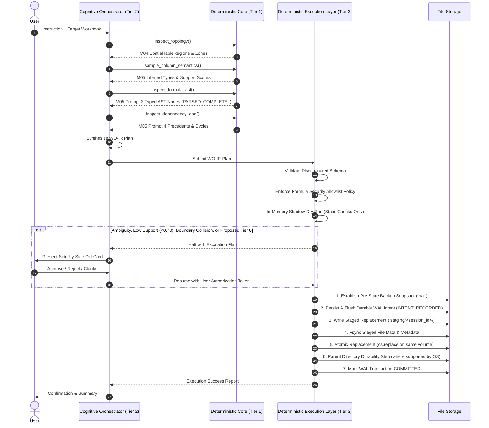

# Autonomous Excel Intelligence Platform V2
## System Architecture Specification (SYSTEM_ARCHITECTURE.md)
### Status: Proposed Architectural Draft (Reconciled with Candidate C, M01–M05 & QA-01)

---

### 1. High-Level Architectural Pattern: Two-Tier Cognitive Topology (Candidate C)

Platform V2 strictly adheres to the approved **Candidate C (Two-Tier Model: Deterministic Core + Tool-Augmented Cognitive Orchestrator)** established in ADR-006, PDR-06, and validated in EXP-09 (demonstrating a 72.5% reduction in token consumption and 70.5% latency reduction compared to multi-agent swarm architectures).

The system maintains a clean separation of concerns without an LLM-agent swarm:
1. **Tier 1: Deterministic Core & Analytical Facades** (High-performance Rust/Python libraries for parsing, spatial detection, typing, formula AST, and graph analysis).
2. **Tier 2: Tool-Augmented Cognitive Orchestrator** (Unified cognitive reasoning model equipped with strongly-typed inspection and synthesis tools).
3. **Tier 3: Deterministic Execution Layer (DEL)** (Sandboxed Python execution engine with targeted Rust extensions enforcing schema validation, shadow dry-runs, WAL durability, and atomic file swaps).

```
+===================================================================================+
|                                  USER INTERFACE                                   |
|             (Natural Language Directives, Side-by-Side Diff Cards, HITL)           |
+===================================================================================+
                                         |
                                         v
+===================================================================================+
|               TIER 2: COGNITIVE ORCHESTRATION LAYER (CANDIDATE C)                 |
|                                                                                   |
|   +---------------------------------------------------------------------------+   |
|   |                      Single-Turn Tool Orchestrator                        |   |
|   |   - Intent Grounding & Context Routing    - Schema-Driven Context Gating   |   |
|   |   - Progressive Window Queries            - WO-IR Plan Synthesis          |   |
|   +---------------------------------------------------------------------------+   |
|                                        |                                          |
|                [Strongly-Typed Inspection Tools (Read-Only RPC)]                  |
|                                        |                                          |
+========================================|==========================================+
                                         |
                                         v
+===================================================================================+
|                     TIER 1: DETERMINISTIC CORE & ANALYTICAL FACADES               |
|                                                                                   |
|   +----------------------------------+  +-------------------------------------+   |
|   |  M02: Streaming OpenXML Parser   |  |  M04: 2D Spatial Table Segmenter    |   |
|   |  - Rust Core (PyO3)              |  |  - BoundingBox & Zone Detection     |   |
|   |  - Sampled 235M/250M Mem Guard   |  |  - Header Hierarchy Resolution      |   |
|   +----------------------------------+  +-------------------------------------+   |
|   +----------------------------------+  +-------------------------------------+   |
|   |  M05 Prompt 2: Semantic Typing   |  |  M05 Prompt 3: Formula AST Subsystem|   |
|   |  - Multi-Pattern Token Classifier|  |  - Scoped EBNF AST Parser           |   |
|   |  - M05 FR-1.6 Support Score S    |  |  - Root: PARSED_COMPLETE, etc.     |   |
|   |  - States (INFERRED, AMBIGUOUS..)|  |  - Typed AST & Ref Nodes Only       |   |
|   +----------------------------------+  +-------------------------------------+   |
|                                         +-------------------------------------+   |
|                                         |  M05 Prompt 4: Dependency DAG & Calc|   |
|                                         |  - Precedent Extraction & Graph DAG |   |
|                                         |  - Tarjan SCC Static Cycle Check    |   |
|                                         |  - Bounded Range-Node Hyperedges    |   |
|                                         +-------------------------------------+   |
+===================================================================================+
                                         |
                       [Schema-Validated WO-IR Plan Package]
                                         |
                                         v
=====================================================================================
=================== DECLARATIVE EXECUTION ISOLATION BOUNDARY ========================
=====================================================================================
                                         |
                                         v
+===================================================================================+
|                     TIER 3: DETERMINISTIC EXECUTION LAYER (DEL)                   |
|                                                                                   |
|   +---------------------------------------------------------------------------+   |
|   | 1. Schema Conformance & Candidate Key Collision Gate                      |   |
|   +---------------------------------------------------------------------------+   |
|                                        |                                          |
|                                        v                                          |
|   +---------------------------------------------------------------------------+   |
|   | 2. Deterministic Formula Security Allowlist Policy Layer                  |   |
|   |    (Blocks external links, DDE, unwhitelisted functions)                  |   |
|   +---------------------------------------------------------------------------+   |
|                                        |                                          |
|                                        v                                          |
|   +---------------------------------------------------------------------------+   |
|   | 3. In-Memory Shadow Model Dry Run                                         |   |
|   |    (Statically resolvable cycles, error literals, boundary checks)        |   |
|   +---------------------------------------------------------------------------+   |
|                                        |                                          |
|                                        v                                          |
|   +---------------------------------------------------------------------------+   |
|   | 4. Risk-Gated HITL Escalation Evaluator (PDR-04 / PDR-05)                 |   |
|   +---------------------------------------------------------------------------+   |
|                                        | (Approved)                               |
|                                        v                                          |
|   +---------------------------------------------------------------------------+   |
|   | 5. COR-01 Seven-Step Durability & Mutation Protocol:                      |   |
|   |    1. Establish pre-state .bak backup                                     |   |
|   |    2. Persist & flush durable WAL intent (INTENT_RECORDED)                |   |
|   |    3. Write staged replacement to .staging/<session_id>/                  |   |
|   |    4. Fsync staged file data and metadata                                 |   |
|   |    5. Atomic replacement using os.replace on same volume                  |   |
|   |    6. Parent-directory durability step where supported by OS              |   |
|   |    7. Mark WAL transaction COMMITTED                                      |   |
|   +---------------------------------------------------------------------------+   |
|                                        |                                          |
|                                        v                                          |
|   +---------------------------------------------------------------------------+   |
|   | 6. Multi-Layer Recovery Engine (Pre-State Snapshot .bak + WAL Deltas)     |   |
|   +---------------------------------------------------------------------------+   |
+===================================================================================+
                                         |
                                         v
                             [Verified Target Workbook]
```

---

### 2. Component Decomposition & Operational Separation

#### 2.1 Tier 2: Cognitive Orchestration Layer
- **Candidate C Single-Turn Execution**: Operates as a single-turn reasoning agent. Rather than spinning up 8 separate LLM dialogs, the orchestrator invokes deterministic tool endpoints:
  - `inspect_topology(sheet)` $\rightarrow$ calls M04 Spatial Segmenter.
  - `sample_column_semantics(table_id, col_idx)` $\rightarrow$ calls M05 Semantic Type Profiler.
  - `inspect_formula_ast(cell_coord)` $\rightarrow$ calls M05 Prompt 3 Formula Parser (typed AST only).
  - `inspect_dependency_dag(cell_coord)` $\rightarrow$ calls M05 Prompt 4 Dependency Graph (precedents and DAG).
  - `synthesize_plan(intent, grounded_schema)` $\rightarrow$ generates declarative WO-IR.
- **Declarative Isolation**: Possesses zero operating system write handles; cannot execute arbitrary scripts; communicates exclusively via JSON. Distinct from physical/network air-gapping. Tier 3 outbound network access policy is governed as an open decision (Decision 7: `PROPOSED / REQUIRES HUMAN APPROVAL`).

#### 2.2 Tier 1: Deterministic Core Engines (Milestone Baselines)
- **Streaming Parser (M02)**: Rust streaming reader with sampled, event-driven memory guard enforcing 235,000,000 bytes warning tripwire (`WARNING_TRIPWIRE_WORKING_SET_BYTES`) and 250,000,000 bytes typed hard-error ceiling (`HARD_CEILING_WORKING_SET_BYTES`) via dual-cadence telemetry (sampled every 1,000 rows) and 8,000,000-byte burst allocation delta triggers (`EVENT_DRIVEN_DELTA_THRESHOLD_BYTES = 8_000_000` in `crates/excel_intel_rs/src/memory_guard.rs`).
- **Structural Facts (M03)**: Extracts declared OpenXML tables (`ListObject`), defined names, and `<calcPr>`.
- **Spatial Grid Segmenter (M04)**: Extracts rectangular boundaries (`BoundingBox`), hierarchical headers, and intra-table semantic zones (`SemanticZoneType.BODY`).
- **Semantic Type Profiler (M05 Prompt 2)**: Classifies column tokens within `BODY`, calculating homogeneity $H$, ambiguity penalties, and heuristic support scores $S$ via approved M05 FR-1.6 formula across the four inference states (`INFERRED`, `UNKNOWN`, `AMBIGUOUS`, `INSUFFICIENT_DATA`). Columns composed entirely of null markers (`N/A`, `-`, `None`) are classified as `AMBIGUOUS`.
- **Formula AST Subsystem (M05 Prompt 3)**: Pure-Python lexer and operator-precedence recursive-descent parser. Emits immutable AST nodes with root statuses `PARSED_COMPLETE`, `UNSUPPORTED_SYNTAX`, or `PARSE_ERROR`. Pure syntactic parsing; zero precedent extraction, zero security policy enforcement, zero runtime evaluation. Category A/B/C are subordinate syntax tags.
- **Dependency Graph & Precedent Subsystem (M05 Prompt 4 Design Scope)**: Ingests AST reference nodes to extract precedents, builds calculation DAGs with Tarjan SCC cycle detection, and preserves bounded range-nodes / hyperedges.
- **Proposed Downstream Integration Adapter (M01 Adapter)**: Converts discovered spatial, type, and formula metadata into canonical M01 `DiscoveryManifest` structures for downstream consolidation.

#### 2.3 Tier 3: Deterministic Execution Layer (DEL)
- **Engine Architecture**: Sandboxed Python execution engine with targeted Rust extensions where specified; not an imaginary fully compiled binary.
- **Formula Security Policy Layer**: Separate deterministic allowlist policy layer enforcing protocol blacklisting (external links, DDE, dangerous functions) and function whitelisting. Rejects unallowed functions even if syntactically valid under standard grammar.
- **Schema & Collision Gate**: Validates WO-IR against strict discriminated schemas and tests candidate keys for duplicate collisions.
- **Shadow In-Memory Dry Run**: Tests proposed modifications in an in-memory clone to detect static formula errors (explicit `#REF!` tokens, static cycles via Tarjan SCC), out-of-bounds references, or boundary collisions. Dynamic runtime formula errors (e.g. dynamic `#VALUE!`, division by zero during evaluation) are explicitly disclaimed.
- **Durable WAL Intent & COR-01 Durability Commit**: Records durable transaction intent before applying mutations. Durability follows the authoritative COR-01 sequence:
  1. Establish pre-state `.bak` backup on local filesystem.
  2. Persist and flush durable WAL intent (`INTENT_RECORDED`).
  3. Write staged replacement to `.staging/<session_id>/` on the same filesystem volume.
  4. Fsync staged file data and metadata via `fsync()`.
  5. Atomic replacement using `os.replace` on the same volume.
  6. Parent-directory durability step where supported by the operating system. Explicitly note that Windows NTFS does not provide POSIX directory `fsync()`, and NTFS journal persistence does not provide an equivalent guaranteed durability primitive for immediate directory entry synchronization. On Windows NTFS, directory entry durability remains subject to OS metadata caching until flushed, presenting an explicit platform durability limitation during sudden host power loss or crash immediately post-replace (staged file content is durable, but directory pointer updates may lag).
  7. Mark WAL transaction `COMMITTED` in the WAL ledger.
- **Three-Tier Recovery Engine**:
  - *Pre-State Snapshot (`.bak`)*: Exact restoration when backup integrity is verified and restore succeeds on local NTFS under tested conditions.
  - *Write-Ahead Log (WAL)*: In-session logical undo/redo via forward and reverse differential patches.
  - *Targeted OpenXML Patching*: Rewrites only modified XML parts (`sheetN.xml`, `calcChain.xml`) with schema-conformant semantic preservation, preserving non-targeted package parts (`vbaProject.bin`, drawings, slicers, media, themes, unedited sheets) bitwise (byte-for-byte) under experimentally verified local NTFS conditions. Universal bitwise preservation is disclaimed.

---

### 3. Component Interaction Flow


