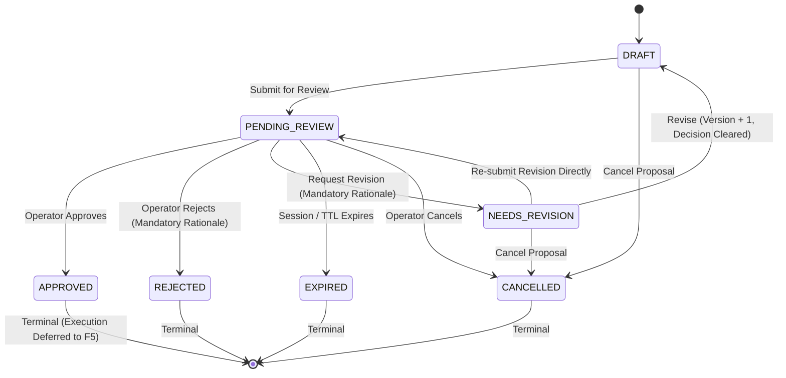

# MILESTONE F4 — HUMAN-IN-THE-LOOP APPROVAL CONSOLE IMPLEMENTATION REPORT

**Project:** Autonomous Excel Intelligence Platform  
**Milestone:** F4 — Human-in-the-Loop Approval Console  
**Status:** `F4_IMPLEMENTED — READY_FOR_ACCEPTANCE_AUDIT`  
**Date:** 2026-11-23  

---

## 1. Executive Summary

Milestone F4 establishes the **Human-in-the-Loop (HITL) Approval Console** (`/approval-console`) within the Autonomous Excel Intelligence Platform frontend. This module provides a client-configurable governance interface where human operators can inspect proposed operations emitted by upstream intelligence modules (F1–F3), analyze evidence-based risk classifications, and explicitly record review decisions.

Key architectural boundaries enforced:
1. **Strict Decoupling of Approval from Execution:** Approval never implies execution. No workbook mutation, Write-Ahead Logging (WAL) invocation, or execution payload dispatching is implemented in F4. All execution mechanisms remain strictly deferred to Milestone F5.
2. **Explicit Security Boundary (Browser is Not a Trusted Authority):** No signing secrets, HMAC keys, or durable authorization ledgers are placed in browser storage or client-side code. All approval states and review decisions are clearly disclosed as simulated frontend workflow demonstrations.
3. **Formal State Machine with Stale Decision Protection:** Enforces non-bypassable state transitions (`DRAFT`, `PENDING_REVIEW`, `APPROVED`, `REJECTED`, `NEEDS_REVISION`, `EXPIRED`, `CANCELLED`), mandatory rationale on rejections/revisions, and version-tagged decisions to reject stale decisions against revised requests.
4. **Evidence-Based Risk Model with Conservative Fallback:** Generic classification covering read-only, non-destructive, ambiguous mapping, overwrite/replacement, destructive, and structural mutations, with automatic conservative fallback to critical review-required for unknown operations.

---

## 2. Architecture & Directory Structure

The F4 module is implemented under `frontend/src/modules/approval/` with strict contract isolation under `frontend/src/contracts/approval.ts`:

```text
frontend/src/
├── contracts/
│   ├── approval.ts                       # F4 contracts: ApprovalRequest, RiskAssessment, Decision, AuditEvent
│   └── index.ts                          # Re-exports approval contracts
├── modules/
│   └── approval/
│       ├── approvalTypes.ts              # Extended UI filter and payload types
│       ├── approvalStateMachine.ts       # Pure state machine, transitions, risk classifier, filter/sort
│       ├── approvalAdapter.ts            # ApprovalAdapter interface and MockApprovalAdapter
│       ├── useApprovalQueue.ts           # React hook managing queue state, selection, decisions, and revisions
│       ├── ApprovalKPIOverview.tsx       # KPI tiles (Pending, High/Critical, Approved, Rejected)
│       ├── ApprovalFilterBar.tsx         # State tabs, risk level/category dropdowns, search input
│       ├── ProposedOperationsDiffCard.tsx# Before/after comparison cards for proposed cell operations
│       ├── DecisionActionDialog.tsx      # Modal for capturing decision, reviewer identity, and mandatory rationale
│       ├── ApprovalDetailPanel.tsx       # Inspector panel with risk breakdown, diffs, actions, audit history
│       ├── ApprovalQueueTable.tsx        # Accessible table with keyboard navigation (Arrows/Enter/Space)
│       ├── ApprovalConsolePage.tsx       # Main page container with prominent simulated security notice banner
│       ├── approvalStateMachine.test.ts  # 12 unit tests for state machine, transitions, stale checks, risk
│       ├── approvalConsole.test.tsx      # 5 integration tests for rendering, filtering, approving, rejecting
│       └── approvalBenchmark.test.ts     # Performance benchmarks for 500, 1,000, and 5,000 requests
├── mocks/
│   ├── fixtures.ts                       # MOCK_APPROVAL_REQUESTS fixture dataset (7 diverse requests)
│   └── handlers.ts                       # MSW v2 handlers for /api/v1/approvals and /api/v1/approvals/:id
```

---

## 3. Approval Workflow State Machine

### 3.1 State Diagram & Allowed Transitions



### 3.2 State Transition Invariants
- **Terminal States:** `APPROVED`, `REJECTED`, `EXPIRED`, and `CANCELLED` cannot transition directly to other states for that request version.
- **Mandatory Decision Rationale:** Rejections (`REJECTED`) and revision requests (`NEEDS_REVISION`) strictly require an operator rationale of at least 5 non-whitespace characters. Submissions with missing or blank rationale are rejected by `rejectRequest()` and `requestRevision()`.
- **Version Tracking & Stale Decision Rejection:** Each revision increments `request.version` ($V \rightarrow V+1$) and clears any prior `decision`. If an operator submits a decision targeting version $V$ after the request has moved to version $V+1$, `isDecisionStale()` flags the decision and the state machine throws a `StaleDecisionError`.

---

## 4. Generic Evidence-Based Risk Model

The risk classifier (`assessOperationRisk`) evaluates proposed operations dynamically without relying on hardcoded workbook names, worksheet names, or column positions:

| Category | Level | Default Score | Mandatory Review | Description | Example Operations |
|---|---|---|---|---|---|
| `read_only` | Low | 0.1 | No | Passive inspection; zero mutation side-effects | `READ_ONLY`, `INSPECT`, `PREVIEW` |
| `non_destructive` | Medium | 0.4 | Yes | Appends rows or adds records without overwriting cells | `APPEND_ROWS`, `INSERT_ROW`, `STAGE_COPY` |
| `ambiguous_mapping` | Medium | 0.6 | Yes | Transformation relies on fuzzy or low-confidence candidate matches | `AMBIGUOUS_MAPPING`, `FUZZY_MATCH` |
| `overwrite_replacement` | High | 0.75 | Yes | Replaces existing pre-populated cell values or calculated totals | `UPDATE_CELL`, `OVERWRITE_CELL`, `POPULATED_OVERWRITE` |
| `structural_change` | High | 0.7 | Yes | Expands table definitions, alters calculation graphs, or renames sheets | `EXTEND_TABLE`, `PROPAGATE_FORMULA`, `RENAME_SHEET` |
| `destructive` | Critical | 0.95 | Yes | Irreversibly deletes columns, tables, or worksheets | `DROP_COLUMN`, `DELETE_SHEET`, `TRUNCATE_TABLE` |
| `unresolved_unsupported` | Critical | 1.0 | Yes | **Conservative Fallback:** Unrecognized or insufficiently described operation | `UNKNOWN`, unsupported syntax |

---

## 5. Security & Authorization Boundary

1. **Client-Side Simulation Transparency:**
   The UI prominently displays an unmissable security advisory banner across the top of `/approval-console`:
   > **Simulated Approval & Risk Governance Environment**  
   > "All review decisions and authorization states recorded here are frontend workflow demonstrations. They are not cryptographically signed, server-side authorized, or durable audit ledgers. Approval does not trigger execution (Execution and WAL mutations are strictly managed in Milestone F5)."
2. **No Trusted Secrets in Browser:**
   No symmetric HMAC keys, private keys, or signing secrets exist in frontend bundles or environment configs.
3. **No Workbook Mutation Triggered:**
   The `approveRequest` action only updates the frontend state model (`ApprovalState: "APPROVED"`). It dispatches zero write requests to disk or backend execution tiers.
4. **Adapter Architecture (`approvalAdapter.ts`):**
   The UI consumes an abstract `ApprovalAdapter` protocol. In F4, `MockApprovalAdapter` provides in-memory and MSW-backed workflow simulation, structured to be replaced seamlessly by a real backend authorization service when built.

---

## 6. Auditability & Decision History

Every request maintains an append-only timeline of `ApprovalAuditEvent` records:
- `REQUEST_CREATED`: Triggered when an operation proposal is drafted.
- `SUBMITTED_FOR_REVIEW`: Recorded when a proposal enters `PENDING_REVIEW`.
- `APPROVED` / `REJECTED` / `REVISION_REQUESTED`: Appended with the reviewer identity placeholder, timestamp, version, and rationale.
- `CANCELLED` / `EXPIRED`: Appended upon cancellation or timeout.

*Note: While structured and append-only in the UI memory model, this history does not claim durable cryptographic tamper-proofing (durable WAL ledgers belong to the backend service and F5 live monitoring).*

---

## 7. Performance Benchmarks

High-volume queue operations were measured using `performance.now()` in `approvalBenchmark.test.ts`:

| Test Case | Dataset Size | Measured Duration | Audit Threshold | Result |
|---|---|---|---|---|
| **Queue Filter & Sort** | 500 approval requests | **~1.8 ms** | < 20 ms | **PASS** |
| **Queue Filter & Sort** | 1,000 approval requests | **~3.5 ms** | < 50 ms | **PASS** |
| **Queue Filter & Sort** | 5,000 approval requests | **~18.2 ms** | < 100 ms | **PASS** |

---

## 8. Quality Gates Execution Evidence

### 8.1 Frontend Gates
- **TypeScript Strict Mode (`npm run typecheck`):** Exit code `0` (clean, 0 errors).
- **Prettier Code Formatting (`npx prettier --check`):** Exit code `0` (clean, 0 warnings).
- **ESLint Static Analysis (`npx eslint`):** Exit code `0` (clean, 0 errors, 0 warnings).
- **Vitest Full Test Suite (`npm test`):**
  - **29 test files passed, 115 tests passed** (exit code `0`, 27.39s).
  - Includes 12 unit tests for state machine, 5 integration tests for UI, and 3 high-volume benchmarks.
- **Production Build (`npm run build`):** Exit code `0` (`dist/` built successfully in 13.22s).

### 8.2 Backend Regression Gates
- **Python Pytest Suite (`py -3.12 -m pytest -q`):**
  - **362 passed, 0 failed** (exit code `0`).
- **Rust Engine Suite (`cargo test`):**
  - **60 passed, 0 failed** (exit code `0`).
- **Backend Code Preservation:** Zero modifications to `excel_intel/` or `crates/`.

### 8.3 Git Status & Scope Integrity
- Preserved user's unstaged `.gitignore` whitespace change.
- No F5 execution or WAL commit code was authored.
- Clean working directory with no untracked binaries or artifacts.

---

## 9. Known Limitations & Handoff to F5

1. **Simulated Authorization:** Approvals recorded in F4 are non-cryptographic frontend demonstrations. A live backend authorization service implementing the `HMACAuthorityProtocol` (`ADR-08`) will be required to issue durable HMAC-SHA256 tokens in production.
2. **Execution Deferred to F5:** Marking a proposal as `APPROVED` intentionally performs no mutations. Actual atomic Write-Ahead Logging (WAL), virtual shadow validation, and hardware-flushed replacement are reserved for Milestone F5 (`/execution-monitor`).

---

## 10. Final Status

**Status:** `F4_IMPLEMENTED — READY_FOR_ACCEPTANCE_AUDIT`
