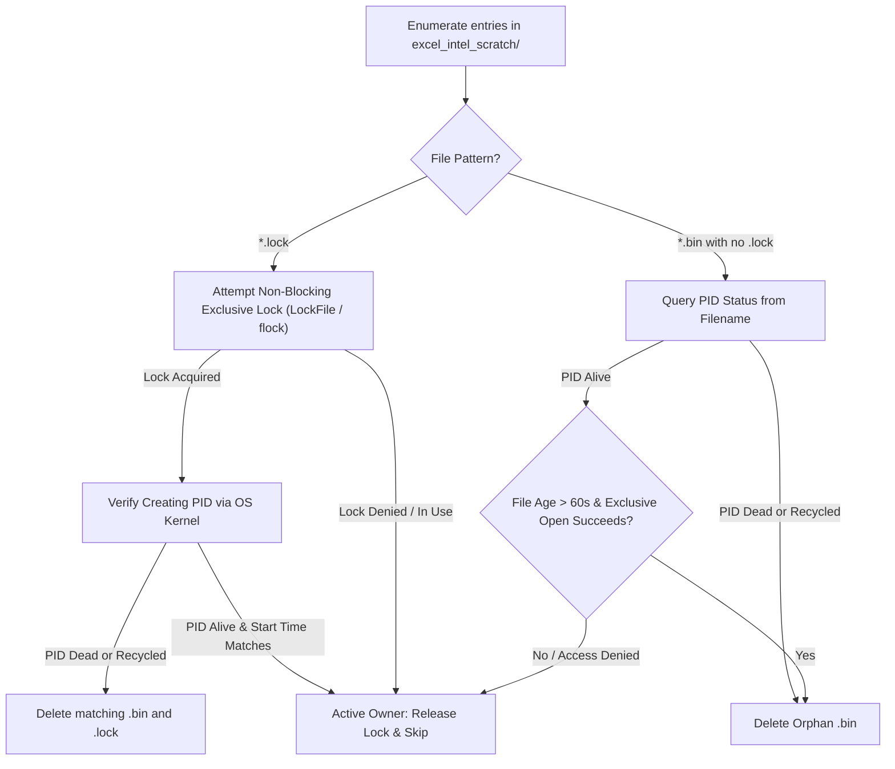

# M02 — SPRINT 2 PLAN v2.2 (FINAL PRE-AUTHORIZATION REPORT)

**Project:** Autonomous Excel Intelligence Platform  
**Module:** M02 — Rust Streaming Parser  
**Sprint:** Sprint 2 (Shared-String Spill Storage, Scratch Lifecycle, Bounded Memory & Parser Integration)  
**Document Status:** Final Pre-Authorization Revision (v2.2)  
**Governance State:** Sprint 1 Accepted and Frozen. **Zero production code modified.**

---

## 1. Technical Corrections and Resolutions

### 1.1 Correction 1: Memory Accounting & Layout Breakdown

#### Exact Data Structure Sizing
The memory layout is recalculated on 64-bit architecture (`std::mem::size_of` with standard alignment padding):

1. **LRU Safe Arena Slot (`LruSlot`):**
   ```rust
   #[repr(C)]
   struct LruSlot {
       key: u32,              // 4 bytes: shared string index
       prev: Option<u32>,     // 4 bytes: arena index
       next: Option<u32>,     // 4 bytes: arena index
       _padding: u32,         // 4 bytes: explicit alignment padding
       payload: Box<str>,     // 16 bytes: fat pointer (data_ptr [8B] + len [8B])
       disk_offset: u64,      // 8 bytes: offset in spill file
   }                          // Total = 40 bytes per slot
   ```
   - For 50,000 slots: $50{,}000 \times 40\text{ bytes} = 2{,}000{,}000\text{ bytes} \approx \mathbf{1.91\text{ MB}}$ *(layout calculation)*.

2. **LRU SwissTable (`hashbrown::HashMap<u32, u32>`):**
   - 1 control byte per bucket + 8 bytes `(u32, u32)` key-value pair.
   - For 50,000 entries at maximum load factor $87.5\%$, capacity is $65{,}536$ buckets:
     $65{,}536 \times 9\text{ bytes} \approx 589{,}824\text{ bytes} \approx \mathbf{0.56\text{ MB}}$ *(layout calculation)*.
   - **Combined LRU Arena + Map Overhead:** $1.91\text{ MB} + 0.56\text{ MB} = \mathbf{2.47\text{ MB}}$ *(calculated layout)*.

3. **Shared Strings Index Table (`Vec<StringEntry>`):**
   - Entry struct `StringEntry { offset: u64, len: u32 }` with alignment is **16 bytes**.
   - At the 2,000,000 sequential string limit: $2{,}000{,}000 \times 16\text{ bytes} = \mathbf{32.00\text{ MB}}$ *(enforced layout)*.

#### Component Accounting Matrix (Distinguishing Verified Limits from Estimates)

| Component | Budget / Allocation Specification | Estimated Footprint | Classification |
|---|---|---|---|
| **Tier 1 Shared-Strings Buffer** | `TIER1_MAX_BYTES` (UTF-8 bytes) | $32.00\text{ MB}$ | **Empirically Enforced Limit** |
| **Tier 2 Disk Spill LRU Payload** | `LRU_MAX_TEXT_BYTES` (cached text) | $16.00\text{ MB}$ | **Empirically Enforced Limit** |
| **Shared-Strings Index Table** | $2\text{M} \times 16\text{ bytes}$ (`StringEntry`) | $32.00\text{ MB}$ | **Layout-Enforced Limit** |
| **LRU Safe Arena + HashMap** | $50\text{K slots} + 65.5\text{K buckets}$ | $2.47\text{ MB}$ | *Calculated Layout Estimate* |
| **Streaming ZIP & Decompress Buffers** | `BufReader` (64 KB) + quick-xml (64 KB) + inflate chunk | $0.25\text{ MB}$ | *Configured Buffer Estimate* |
| **Active Row Chunk & PyObjects** | Default 1,000 rows $\times \approx 20\text{ cells}$ + PyDicts | $4.00\text{ MB}$ | *Transient Chunk Estimate* |
| **Allocator Metadata & Bin Padding** | Windows LFH per-allocation metadata ($\approx 12\%$) | $12.00\text{ MB}$ | *Empirical Allocator Estimate* |
| **Total Estimated Peak Footprint** | Sum of all parser components | **$\mathbf{98.72\text{ MB}}$** | *Estimated Upper Bound* |

> [!IMPORTANT]
> **No Theoretical Hard Guarantee:** The total upper bound of $98.72\text{ MB}$ is an engineering budget estimate. A hard memory guarantee cannot be asserted from calculations alone. Final verification requires physical RSS measurement against the 100K-row benchmark (`BENCH-SCALE-100K.xlsx`) during Sprint 2 acceptance testing.

---

### 1.2 Correction 2: RSS Sampling & Peak Detection

#### Recalibrated Sampling Interval
- Expected and measured streaming throughput across Phase 0 benchmarks is $\approx 100{,}000\text{ rows/sec}$.
- The **1,000-row sampling interval** represents an expected measurement cadence of:
  $$\Delta t_{\text{cadence}} = \frac{1{,}000\text{ rows}}{100{,}000\text{ rows/sec}} = 0.010\text{ s} = \mathbf{10.0\text{ ms (100 Hz)}}$$
- At $10.0\text{ ms}$, querying OS memory counters (`K32GetProcessMemoryInfo`, $\approx 1.2\,\mu\text{s}$) consumes $\le 0.015\%$ CPU overhead.

#### Event-Driven Trigger Interaction (+8 MB)
- An internal atomic counter tracks accumulated attributable memory growth ($\Delta M_{\text{attributable}}$) between cadence intervals.
- If an allocation burst adds $\ge 8.0\text{ MB}$ before the next 1,000 rows elapse, the counter trips an **immediate synchronous OS RSS sample**.
- If absolute process RSS reaches or exceeds **235.0 MB**, execution aborts immediately with `PlatformResourceLimitError(ERR_PEAK_RSS_EXCEEDED)`, preserving the **250.0 MB contractual peak target**.

#### Limitations of External 100 Hz Polling & Kernel Peak Reporting
- *Limitation:* External 100 Hz polling is a discrete sampled measurement; sub-interval transient spikes lasting $<10\text{ ms}$ can escape discrete detection.
- *Kernel High-Water Mark Cross-Validation:*
  - The Windows kernel tracks `PeakWorkingSetSize` continuously at the page-fault level.
  - The benchmark runner (`run_m02_benchmarks.py`) captures:
    1. $Peak_{\text{sampled}}$: Maximum sampled point from the 100 Hz polling thread.
    2. $Peak_{\text{kernel}}$: Final `PeakWorkingSetSize` reported by `PROCESS_MEMORY_COUNTERS`.
  - Any transient peak missed between samples is explicitly reported in the benchmark output as:
    $$\Delta_{\text{untracked}} = Peak_{\text{kernel}} - Peak_{\text{sampled}}$$

---

### 1.3 Correction 3: Race-Resistant Scratch Creation & Scavenging Protocol

#### Lock-First Creation Protocol
To prevent a newly created `.bin` file from ever appearing as an orphaned or unowned candidate to concurrent scavengers, the creation order is inverted:
1. **Acquire Lock First:** Create and lock `m02_spill_<pid>_<timestamp_nanos>_<uuid>.lock` using `CreateFileW` with `FILE_SHARE_NONE` and `LockFile`.
2. **Create Spill File Second:** Only after exclusive lock ownership is held, create `m02_spill_<pid>_<timestamp_nanos>_<uuid>.bin`.
- **Invariant:** A `.bin` file on disk is *always* protected by an existing, held `.lock` handle.

#### Race-Free Ownership Protocol & Scavenger Rules


#### Corrected PID and Start-Time Validation
- **Windows:**
  1. Open handle with `OpenProcess(PROCESS_QUERY_LIMITED_INFORMATION, FALSE, pid)`.
  2. If process does not exist (`ERROR_INVALID_PARAMETER`) $\rightarrow$ process is dead.
  3. If handle opens, query `GetProcessTimes(hProcess, &creation_time, ...)`.
  4. Compare `creation_time` (nanoseconds) with `timestamp_nanos` from filename:
     - If `creation_time > timestamp_nanos`: The PID was recycled by the OS after the original creator died $\rightarrow$ safe to delete.
     - If `creation_time == timestamp_nanos` (within 1 ms tolerance): The original creator is active $\rightarrow$ **DO NOT TOUCH**.
- **POSIX Parity:** Uses `kill(pid, 0)` combined with `/proc/<pid>/stat` field 22 (`starttime`) to guard against PID recycling.

---

### 1.4 Correction 4: Concurrency Safety & Global Lock Hierarchy

#### Global Lock Acquisition Hierarchy
To strictly prevent deadlocks across concurrent multi-threaded operations, locks must be acquired in descending hierarchical order:
$$\mathbf{L_1: Mutex<ScratchSpillFile>} \longrightarrow \mathbf{L_2: Mutex<LruArena>}$$

- **Locking Rules:**
  - **Tier 1 (RAM):** Completely **lock-free**. The contiguous buffer `tier1_buf` is immutable after initial XML ingestion. Reads for $i < \text{spill\_threshold}$ require zero mutex locking.
  - **Tier 2 (Disk/LRU):**
    1. Acquire $L_2$ (`Mutex<LruArena>`). On cache hit: copy string slice, release $L_2$, return.
    2. On cache miss: release $L_2$; acquire $L_1$ (`Mutex<ScratchSpillFile>`); seek and read raw disk bytes; acquire $L_2$ to insert into arena; release $L_2$; release $L_1$.
    - *Invariance:* $L_2$ is never held while awaiting $L_1$. Reverse acquisition ($L_2 \rightarrow L_1$) is statically prohibited.

#### Concurrency Model & Multi-Reader Tests
- **Python / Rust Concurrency Model:**
  - `SharedStringsTable` is wrapped in `Arc<SharedStringsTable>`.
  - Python generator iteration (`SheetChunkIterator`) releases the GIL during raw XML decompression and re-acquires it strictly during Python object allocation.
  - Supported: Multiple OS threads reading from distinct sheets or querying the same reader concurrently.
- **Dedicated Multi-Threaded Tests:**
  1. `test_concurrent_same_index_miss`: 8 threads simultaneously query the exact same cold spilled index; verifies serialized disk reads and atomic cache population without redundant disk seeks or data corruption.
  2. `test_concurrent_lru_thrashing`: 4 threads perform 50,000 rapid lookups forcing continuous evictions; verifies that the index-backed arena maintains linked-list integrity under contention.
  3. `test_concurrent_reader_isolation`: Independent readers on separate workbooks verify complete scratch-file isolation and prove reader A cannot delete or access reader B's scratch files.
  4. `test_concurrent_cancellation_cleanup`: One thread terminates mid-read with an exception; verifies `Arc` reference counting prevents file deletion until the last reader releases its handle.

---

## 2. Final Implementation Sequence (Upon Authorization)

```
Step 1: Safe Arena LRU Refactoring (crates/excel_intel_rs/src/shared_strings.rs)
  ├── Replace raw pointers (NonNull<LruNode>) with index-backed arena (Vec<LruSlot>).
  ├── Implement L1 -> L2 hierarchical lock ordering in Tier 2 lookups.
  └── Add Rust unit tests for eviction, promotion, and same-index contention.

Step 2: Lock-First Scratch Protocol & Scavenger (crates/excel_intel_rs/src/scratch.rs)
  ├── Invert creation order: lock .lock file before creating .bin spill file.
  ├── Implement PID creation-time verification via GetProcessTimes.
  ├── Add orphan .bin detection and concurrent scavenger non-interference tests.
  └── Maintain POSIX flock / /proc/<pid>/stat parity.

Step 3: Dual-Cadence Memory Guard Telemetry (crates/excel_intel_rs/src/memory_guard.rs)
  ├── Set sampling cadence to 1,000 rows (~10 ms at 100K rows/sec).
  ├── Implement +8.0 MB attributable delta event-driven trigger.
  └── Implement synthetic test verifying 235.0 MB defensive abort tripwire.

Step 4: Integration Test Suite & Concurrency Validation (tests/)
  ├── test_shared_strings_spill.py (spill transition, 2M limit, round-trip fidelity).
  ├── test_scratch_lifecycle.py (normal, exception, panic, concurrent scavenging).
  └── test_bounded_memory.py (working set tracking, 235 MB abort, 100 Hz sampling).

Step 5: Quality Gates, Wheel Rebuild & Evidence Report
  ├── Run cargo fmt --check, cargo clippy -- -D warnings, cargo test.
  ├── Build abi3 wheel; execute pytest across Python 3.12 and 3.13.
  ├── Run benchmark harness with kernel PeakWorkingSetSize cross-validation.
  └── Author M02_SPRINT_2_EVIDENCE_REPORT.md and STOP.
```

---

## 3. Exact Files Expected to Change

### Rust Production Crates (`crates/excel_intel_rs/src/`):
- `shared_strings.rs`: Safe arena LRU refactoring, lock ordering, capacity validation.
- `scratch.rs`: Lock-first creation, PID start-time validation, extended scavenger.
- `memory_guard.rs`: 1,000-row cadence, +8 MB event trigger, OS query telemetry.
- `worksheet.rs`: Integration of dual-cadence check into streaming row loop.
- `lib.rs`: Thread-safe shared strings binding in `PyStreamingWorkbookReader`.

### Python Integration & Benchmark Tests (`tests/`):
- `tests/test_shared_strings_spill.py`: Dedicated tiered storage test suite.
- `tests/test_scratch_lifecycle.py`: Dedicated scratch file lifecycle & scavenger suite.
- `tests/test_bounded_memory.py`: Defensive abort and working set test suite.
- `tests/benchmarks/run_m02_benchmarks.py`: 100 Hz sampling + kernel peak reporting.

---

## 4. Measurable Acceptance Criteria

1. **Zero Regressions:** 100% pass across all 16 existing Rust unit tests and 87 Python integration tests in both Python 3.12 and Python 3.13.
2. **Safe Arena Invariant:** 0 occurrences of `unsafe` raw pointers in `shared_strings.rs`.
3. **Tiered Spill Accuracy:** Bit-exact string equality across 120,000 strings transitioning across Tier 1 (100,000 strings / 32 MB) and Tier 2 (disk/LRU).
4. **Ceiling Enforcement:** String 2,000,001 rejected with `ERR_SHARED_STRINGS_OVERFLOW`.
5. **Zero Leaked Scratch Files:** Exactly 0 residual `.bin` or `.lock` files in `excel_intel_scratch/` after normal execution or error aborts.
6. **Concurrent Non-Interference:** 0 lock deadlocks or file access errors under 8-thread concurrent same-index lookups and parallel reader instances.
7. **Defensive Tripwire:** Aborts at 235.0 MB working set with `ERR_PEAK_RSS_EXCEEDED` before reaching 250 MB contractual ceiling.

---

## 5. Remaining Known Limitations

1. **Sampled vs Kernel Peak:** 100 Hz polling cannot guarantee capturing sub-10ms transient spikes; this is mitigated by reporting kernel-level `PeakWorkingSetSize` alongside sampled peaks.
2. **Disk I/O Latency:** Accessing cold spilled strings that miss the 16 MB LRU cache incurs physical disk seek latency; mitigated by LRU caching of hot keys.
3. **Non-Windows Environments:** Linux/macOS support uses POSIX `flock` and `/proc` queries; full kernel continuous peak tracking relies on OS-specific telemetry.

---

## 6. Production Code Declaration

**Explicit Confirmation:** Zero production code, test code, or build configuration files have been modified. Sprint 1 remains frozen. Implementation of Sprint 2 has **not** begun and will not commence without explicit Project Owner authorization.
