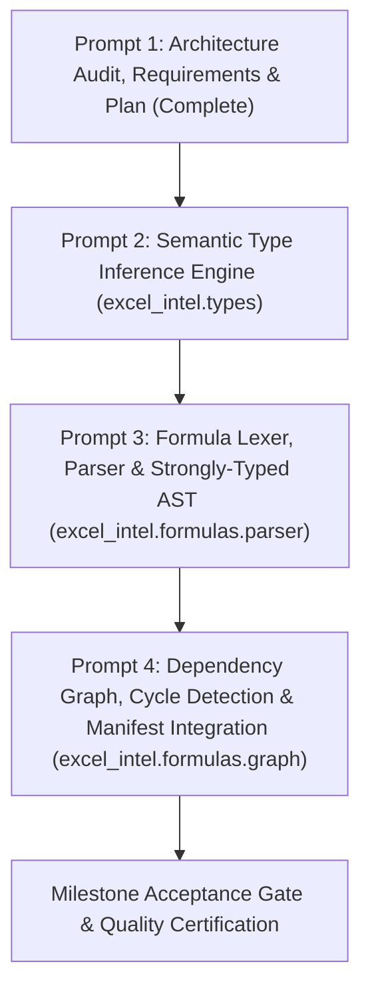

# Milestone M05 — Semantic Type & Formula Analysis
## Document 3 of 4: Comprehensive Implementation Plan

**Date:** 2026-11-22  
**Milestone:** M05 — Semantic Type & Formula Analysis  
**Stage:** Prompt 1 of 4 (Architecture Inspection, Requirements Discovery & Planning)  
**Status:** COMPLETE (Planning & Audit Only — Zero Code Modification)  
**Branch:** `main` (Strict Zero Autonomous Commits/Pushes)

---

## 1. Subsystem Architecture & Package Topology

Milestone M05 introduces two cohesive, domain-agnostic packages under `excel_intel`:

```
excel_intel/
├── types/                     # Semantic Data Type Inference Subsystem
│   ├── __init__.py            # Public exports (TypeInferenceEngine, ColumnTypeProfile, etc.)
│   ├── models.py              # Frozen Pydantic v2 data contracts for type profiling
│   ├── pattern_detector.py    # Deterministic pattern matching (numbers, dates, bools, currency, nulls)
│   └── inferrer.py            # TypeInferenceEngine sampling BODY zone and computing support scores
│
├── formulas/                  # Formula Intelligence & Dependency Graph Subsystem
│   ├── __init__.py            # Public exports (FormulaParser, FormulaAST, FormulaGraph, etc.)
│   ├── ast_nodes.py           # Frozen Pydantic v2 AST node models (Category A, B, C)
│   ├── lexer.py               # Deterministic lexical analyzer and tokenizer
│   ├── parser.py              # Recursive-descent formula AST parser with status guard
│   ├── graph.py               # Directed calculation DAG & precedent/dependent index
│   └── cycle_detector.py      # Tarjan's SCC and range containment cycle detection
│
└── analyzer.py                # Subsystem Facade coordinating M04 spatial tables + M05 types + M05 formulas
```

---

## 2. Proposed Data Contracts & Schemas

All schemas are frozen Pydantic v2 models with strict type validation.

### 2.1 Semantic Type Data Contracts (`excel_intel/types/models.py`)

```python
from enum import Enum
from typing import Any, Optional
from pydantic import BaseModel, ConfigDict, Field
from excel_intel.core.types import ColumnType

class InferenceState(str, Enum):
    """Explicit state of column semantic type inference."""
    INFERRED = "INFERRED"                      # Clear predominant type (H >= 0.80, S >= 0.70)
    UNKNOWN = "UNKNOWN"                        # 100% empty, blank, or all null markers
    AMBIGUOUS = "AMBIGUOUS"                    # Low homogeneity (H < 0.80) or semantic ambiguity
    INSUFFICIENT_DATA = "INSUFFICIENT_DATA"    # Populated count below statistical threshold (< 5)

class ValueCategory(str, Enum):
    """Fine-grained semantic value category."""
    INTEGER = "INTEGER"
    DECIMAL = "DECIMAL"
    DATE = "DATE"
    BOOLEAN = "BOOLEAN"
    STRING = "STRING"
    CURRENCY = "CURRENCY"
    PERCENTAGE = "PERCENTAGE"
    NULL = "NULL"
    ERROR = "ERROR"
    FORMULA = "FORMULA"

class ColumnTypeProfile(BaseModel):
    """Detailed statistical profile of a single column within BODY zone."""
    col_index: int = Field(ge=1, le=16384)
    state: InferenceState
    candidate_type: Optional[ColumnType] = None  # None for UNKNOWN or AMBIGUOUS
    total_cells: int = Field(ge=0)
    populated_cells: int = Field(ge=0)
    null_cells: int = Field(ge=0)
    nullability_ratio: float = Field(ge=0.0, le=1.0)
    category_counts: dict[str, int] = Field(default_factory=dict)
    inferred_type: ColumnType                    # Projected carrier for M01 compatibility
    heuristic_support_score: float = Field(ge=0.0, le=1.0)
    is_ambiguous: bool = False
    ambiguity_reason: Optional[str] = None
    competing_types: list[ValueCategory] = Field(default_factory=list)
    requires_human_review: bool = False
    sample_values: list[Any] = Field(default_factory=list)
    formula_pattern: Optional[str] = None
    model_config = ConfigDict(frozen=True)

class RegionTypeReport(BaseModel):
    """Type inference report for an entire detected spatial table region."""
    region_id: str
    sheet_name: str
    body_row_start: int = Field(ge=1)
    body_row_end: int = Field(ge=1)
    columns: dict[int, ColumnTypeProfile] = Field(default_factory=dict)
    has_ambiguous_columns: bool = False
    sampled_row_count: int = Field(ge=0)
    total_row_count: int = Field(ge=0)
    sampled_col_count: int = Field(ge=0)
    total_col_count: int = Field(ge=0)
    sampled_cell_count: int = Field(ge=0, le=10000)
    is_truncated: bool = False
    truncation_details: Optional[str] = None
    model_config = ConfigDict(frozen=True)
```

### 2.2 Formula AST Node Contracts (`excel_intel/formulas/ast_nodes.py`)

```python
from enum import Enum
from typing import Any, Optional
from pydantic import BaseModel, ConfigDict, Field

class FormulaParseStatus(str, Enum):
    """Status of formula parsing result."""
    PARSED_COMPLETE = "PARSED_COMPLETE"
    UNSUPPORTED_SYNTAX = "UNSUPPORTED_SYNTAX"
    PARSE_ERROR = "PARSE_ERROR"

class ASTNodeType(str, Enum):
    LITERAL = "LITERAL"
    CELL_REFERENCE = "CELL_REFERENCE"
    RANGE_REFERENCE = "RANGE_REFERENCE"
    STRUCTURED_REFERENCE = "STRUCTURED_REFERENCE"
    FUNCTION_CALL = "FUNCTION_CALL"
    UNARY_OP = "UNARY_OP"
    BINARY_OP = "BINARY_OP"
    POSTFIX_OP = "POSTFIX_OP"
    ARRAY_LITERAL = "ARRAY_LITERAL"
    UNSUPPORTED = "UNSUPPORTED"
    UNPARSED = "UNPARSED"

class BaseASTNode(BaseModel):
    node_type: ASTNodeType
    span: tuple[int, int] = Field(description="Character start and end offsets in raw formula")
    model_config = ConfigDict(frozen=True)

class LiteralNode(BaseASTNode):
    node_type: ASTNodeType = ASTNodeType.LITERAL
    value: Any
    literal_kind: str

class CellReferenceNode(BaseASTNode):
    node_type: ASTNodeType = ASTNodeType.CELL_REFERENCE
    sheet_name: Optional[str] = None
    col: int = Field(ge=1, le=16384)
    row: int = Field(ge=1, le=1048576)
    col_absolute: bool = False
    row_absolute: bool = False
    raw_reference: str

class RangeReferenceNode(BaseASTNode):
    node_type: ASTNodeType = ASTNodeType.RANGE_REFERENCE
    sheet_name: Optional[str] = None
    start_cell: CellReferenceNode
    end_cell: CellReferenceNode
    is_full_col: bool = False
    is_full_row: bool = False

class StructuredReferenceNode(BaseASTNode):
    node_type: ASTNodeType = ASTNodeType.STRUCTURED_REFERENCE
    table_name: Optional[str] = None
    column_name: str
    specifier: Optional[str] = None
    is_this_row: bool = False

class FunctionCallNode(BaseASTNode):
    node_type: ASTNodeType = ASTNodeType.FUNCTION_CALL
    function_name: str
    arguments: list[BaseASTNode] = Field(default_factory=list)

class BinaryOpNode(BaseASTNode):
    node_type: ASTNodeType = ASTNodeType.BINARY_OP
    operator: str
    left: BaseASTNode
    right: BaseASTNode

class UnaryOpNode(BaseASTNode):
    node_type: ASTNodeType = ASTNodeType.UNARY_OP
    operator: str
    operand: BaseASTNode

class PostfixOpNode(BaseASTNode):
    node_type: ASTNodeType = ASTNodeType.POSTFIX_OP
    operator: str
    operand: BaseASTNode

class ArrayLiteralNode(BaseASTNode):
    node_type: ASTNodeType = ASTNodeType.ARRAY_LITERAL
    rows: list[list[BaseASTNode]] = Field(default_factory=list)

class UnsupportedFormulaNode(BaseASTNode):
    node_type: ASTNodeType = ASTNodeType.UNSUPPORTED
    raw_formula: str
    syntax_category: str

class UnparsedFormulaNode(BaseASTNode):
    node_type: ASTNodeType = ASTNodeType.UNPARSED
    raw_formula: str
    error_message: str
    error_position: int

class FormulaParseResult(BaseModel):
    raw_formula: str
    status: FormulaParseStatus
    ast: Optional[BaseASTNode] = None
    error_message: Optional[str] = None
    model_config = ConfigDict(frozen=True)
```

### 2.3 Formula Dependency Graph Contracts (`excel_intel/formulas/graph.py`)

```python
class DependencyEdge(BaseModel):
    precedent_ref: str
    dependent_ref: str
    is_range_edge: bool = False
    is_cross_sheet: bool = False
    is_external: bool = False
    model_config = ConfigDict(frozen=True)

class FormulaGraphReport(BaseModel):
    node_count: int = Field(ge=0)
    edge_count: int = Field(ge=0)
    formula_count: int = Field(ge=0)
    has_cycles: bool = False
    cycle_status: str = "CYCLE_FREE"  # "CYCLE_FREE", "CYCLES_DETECTED", "UNCERTAIN_INCOMPLETE_DEPENDENCIES"
    circular_paths: list[list[str]] = Field(default_factory=list)
    volatile_cells: list[str] = Field(default_factory=list)
    external_references: list[str] = Field(default_factory=list)
    unsupported_formulas: list[str] = Field(default_factory=list)
    unparsed_formulas: list[str] = Field(default_factory=list)
    is_complete: bool = True
    is_truncated: bool = False
    truncation_details: Optional[str] = None
    model_config = ConfigDict(frozen=True)
```

---

## 3. Core Algorithms & Mathematical Formulations

### 3.1 Strict 10,000-Cell Sampling Budget & Inference
For each column within a detected table's `SemanticZoneType.BODY` zone:
1. **Deterministic 2D Slicing ($B_{\text{cells}} = 10,000$):**
   - Let body bounds span $R$ rows and $C$ columns.
   - $C_{\text{sample}} = \min(C, 1,000)$ if $C > 100$, else $C$. When $C > C_{\text{sample}}$, deterministically slice left ($40\%$), middle ($20\%$), and right ($40\%$) column bands across table width.
   - If $C > 10,000$: $C_{\text{sample}} = 10,000$, and $R_{\text{sample}} = 1$.
   - $R_{\text{sample}} = \min(R, \lfloor 10,000 / C_{\text{sample}} \rfloor)$. When $R > R_{\text{sample}}$, deterministically slice head ($40\%$), middle ($20\%$), and tail ($40\%$) row bands.
   - *Proof:* Total sampled cells $= C_{\text{sample}} \times R_{\text{sample}} \le 10,000$ strictly.
2. **Streaming Cell Categorization:**
   - Stream rows using `StreamingWorkbookReader.stream_sheet(chunk_size=1000)`.
   - Skip empty coordinates in sparse tables without matrix allocation.
   - For declared merges, attribute anchor value across span; non-anchor empty slots are never counted as nulls.
   - For hidden rows/cols, include in profiling; flag `is_hidden = True` in sampling diagnostics.
3. **State Precedence & Heuristic Support Score ($S$):**
   - Let $N_{\text{pop}} = N_{\text{total}} - N_{\text{null}}$.
   - If $N_{\text{pop}} = 0$: `state = InferenceState.UNKNOWN`, `candidate_type = None`, `heuristic_support_score = 0.0`.
   - If $1 \le N_{\text{pop}} < 5$: `state = InferenceState.INSUFFICIENT_DATA`, `candidate_type = T_{\text{pred}}` (prov.), `heuristic_support_score = S`, `requires_human_review = True`.
   - Else:
     $$H = \frac{N_{T_{\text{pred}}}}{N_{\text{pop}}}$$
     $$\text{Penalty}_{\text{ambiguity}} = \begin{cases} 
     0.0 & \text{if } H \ge 0.95 \\ 
     0.10 & \text{if } 0.80 \le H < 0.95 \\ 
     0.25 & \text{if } H < 0.80 
     \end{cases}$$
     $$S = \max\left(0.0, \min\left(1.0, H \times (1.0 - \text{Penalty}_{\text{ambiguity}})\right)\right)$$
     - If semantic ambiguity exists (date format ambiguity, boolean vs integer `0/1`): `state = InferenceState.AMBIGUOUS`, `requires_human_review = True` (regardless of $S$).
     - Else if $H < 0.80$: `state = InferenceState.AMBIGUOUS`, `requires_human_review = True`.
     - Else: `state = InferenceState.INFERRED`, `candidate_type = T_{\text{pred}}`.

### 3.2 Formal Formula Grammar & Precedence Parsing
1. **Explicit Production Rules (EBNF):**
   - Implements full EBNF defined in Section 3.2 of the Requirements specification.
   - Separates syntax recognition from semantic calculation.
2. **Syntax Tiers:**
   - Category A: Emits typed AST nodes (`CellReferenceNode`, `RangeReferenceNode`, etc.).
   - Category B: Emits `UnsupportedFormulaNode` with character span and raw text.
   - Category C: Emits `UnparsedFormulaNode` with error offset and raw text.
3. **Status Guard:** Emits `FormulaParseResult`. If any node is `UnsupportedFormulaNode` or `UnparsedFormulaNode`, `status` is set to `UNSUPPORTED_SYNTAX` or `PARSE_ERROR`, strictly preventing partial parsing from being reported as complete.

### 3.3 Directed Calculation Graph & Cycle Detection
1. **Node & Edge Construction:**
   - Precedents extracted from AST.
   - Ranges $\le 1,000$ cells expand to discrete cell edges $(c \rightarrow V)$.
   - Ranges $> 1,000$ cells or unbounded (`A:A`) remain Range Nodes $(R \rightarrow V)$.
2. **Cycle Detection:**
   - *Direct Containment:* If $V = (s_v, r_v, c_v)$ and precedent range $R = (s_v, r_{\min}..r_{\max}, c_{\min}..c_{\max})$ has $r_{\min} \le r_v \le r_{\max}$ and $c_{\min} \le c_v \le c_{\max}$, detect immediate cycle $V \rightarrow R \rightarrow V$.
   - *Transitive Cycles:* Run Tarjan's SCC across the directed graph. Any component with $|V| > 1$ or self-loops records exact cycle paths.
3. **Incomplete Dependency Handling:**
   - If `is_complete = False` (due to unsupported formulas or unresolved names), `cycle_status` is strictly set to `UNCERTAIN_INCOMPLETE_DEPENDENCIES`. It **never claims `has_cycles = False` with certainty**.
4. **Static Analysis Disclaimer:**
   - Static dependency analysis strictly maps calculation topology; it **does NOT calculate formula results or evaluate expressions**.

---

## 4. M01 Contract Compatibility & Lossy Projection Audit

| Proposed M05 Analytical Output | Target M01 Contract Model & Field | Field Compatibility | Information Lost During M01 Projection |
| :--- | :--- | :---: | :--- |
| `ColumnTypeProfile.inferred_type` | `ColumnMetadata.inferred_type: ColumnType` | **Schema Compatible** | **Lossy Projection:** Fine-grained `CURRENCY` and `PERCENTAGE` are collapsed into `ColumnType.DECIMAL`. `UNKNOWN`, `AMBIGUOUS`, and `INSUFFICIENT_DATA` states are projected to `ColumnType.STRING` carrier. |
| `ColumnTypeProfile.heuristic_support_score` | `ColumnMetadata.type_confidence: float` | **Schema Compatible** | Preserves score in $[0.0, 1.0]$. (True calculated support score preserved without clamping). |
| `ColumnTypeProfile.nullability_ratio` | `ColumnMetadata.nullable: bool` | **Schema Compatible** | **Lossy Projection:** Quantitative ratio ($N_{\text{null}} / N_{\text{total}}$) is collapsed into binary boolean flag (`nullable = True`). |
| `ColumnTypeProfile.formula_pattern` | `ColumnMetadata.formula_pattern: Optional[str]` | **Schema Compatible** | Preserves canonical parameterized pattern string. |
| `TableTypeReport` + `SpatialTableRegion` | `TableMetadata` (`sheet_name`, `bounding_box`, `header_row`, `columns`, `is_list_object`) | **Schema Compatible** | Full conversion via M04 `export_to_table_metadata_list()`. |
| `FormulaGraphReport.node_count` | `FormulaGraphMetadata.node_count: int` | **Schema Compatible** | Populated directly. |
| `FormulaGraphReport.edge_count` | `FormulaGraphMetadata.edge_count: int` | **Schema Compatible** | Populated directly. |
| `FormulaGraphReport.has_cycles` | `FormulaGraphMetadata.has_cycles: bool` | **Schema Compatible** | **Lossy Projection:** Exact cycle paths (`circular_paths: list[list[str]]`) and cycle status are collapsed into a single boolean `has_cycles`. |
| `FormulaGraphReport.volatile_cells` | `FormulaGraphMetadata.volatile_cells: list[str]` | **Schema Compatible** | Populated directly from volatile function index. |
| Complete M05 Manifest | `DiscoveryManifest` (`manifest_id`, `workbook_path`, `sha256`, `tables`, `formula_graph`) | **Schema Compatible** | **Lossy Projection:** Rich AST node trees, dependency edge lists, and category counts are omitted from M01 manifest. |

---

## 5. Implementation Roadmap (Prompts 1 through 4)



### Prompt 1: Architecture Audit, Requirements Discovery, Implementation Plan & Test Strategy
- **Scope:** Complete repository inspection, baseline analysis, requirements definition, data contracts design, and test strategy.
- **Deliverables:**
  - `M05_SEMANTIC_ANALYSIS_ARCHITECTURE_AUDIT.md`
  - `M05_SEMANTIC_ANALYSIS_REQUIREMENTS.md`
  - `M05_SEMANTIC_ANALYSIS_IMPLEMENTATION_PLAN.md`
  - `M05_SEMANTIC_ANALYSIS_TEST_STRATEGY.md`
  (mirrored under `docs/milestones/m05/`).
- **Stop Condition:** Planning and documentation only. Zero production code. Halt for Project Owner sign-off.

### Prompt 2: Semantic Type Inference Engine (`excel_intel/types`)
- **Scope:**
  - Implement `excel_intel/types/models.py`, `pattern_detector.py`, and `inferrer.py`.
  - Implement zone-constrained sampling within `SemanticZoneType.BODY` with hard 10,000-cell budget.
  - Implement explicit inference states (`INFERRED`, `UNKNOWN`, `AMBIGUOUS`, `INSUFFICIENT_DATA`), state precedence, heuristic support scores, and provisional 0.80 ambiguity telemetry.
  - Implement safe projection bridge to M04 `SpatialDetector.export_to_table_metadata_list()` producing valid canonical M01 `TableMetadata`.
- **Deliverables:**
  - Production code in `excel_intel/types/`.
  - Comprehensive unit and edge-case tests in `tests/test_m05_types.py`.
  - Evidence report `M05_PROMPT_2_EVIDENCE_REPORT.md`.
- **Stop Condition:** Halt and await review before starting Prompt 3.

### Prompt 3: Formula Lexer, Parser & Strongly-Typed AST (`excel_intel/formulas/parser`)
- **Scope:**
  - Implement `excel_intel/formulas/ast_nodes.py`, `lexer.py`, and `parser.py`.
  - Pure Python recursive-descent parser handling Category A supported grammar, Category B recognized-unsupported syntax (`UnsupportedFormulaNode`), and Category C malformed syntax (`UnparsedFormulaNode`).
  - Character span preservation and status guard (`FormulaParseResult`).
  - Extract precedent references from AST.
- **Deliverables:**
  - Production code in `excel_intel/formulas/`.
  - Comprehensive grammar and adversarial syntax tests in `tests/test_m05_formula_parser.py`.
  - Evidence report `M05_PROMPT_3_EVIDENCE_REPORT.md`.
- **Stop Condition:** Halt and await review before starting Prompt 4.

### Prompt 4: Dependency Graph, Calculation DAG & Canonical Manifest Integration
- **Scope:**
  - Implement `excel_intel/formulas/graph.py` and `cycle_detector.py`.
  - Directed calculation graph construction with bounded range expansion ($K \le 1,000$).
  - Direct range containment and Tarjan's SCC cycle detection, with `UNCERTAIN_INCOMPLETE_DEPENDENCIES` status guard.
  - Volatile function cataloging (`FormulaGraphMetadata.volatile_cells`).
  - Subsystem facade assembling canonical M01 `DiscoveryManifest`.
  - Multi-language regression (Python 3.12/3.13 + Rust), performance benchmarks, and formal milestone closure.
- **Deliverables:**
  - Production code for formula graph and manifest facade.
  - Comprehensive graph and cycle detection tests in `tests/test_m05_formula_graph.py` and `tests/test_m05_manifest_integration.py`.
  - Evidence reports: `M05_PROMPT_4_EVIDENCE_REPORT.md` and `M05_FINAL_CLOSURE_REPORT.md`.
- **Stop Condition:** Formal milestone sign-off.

---

## 6. Unresolved Architectural Decisions Requiring Approval

1. **Provisional 0.80 Homogeneity Threshold:** Designated provisional; columns with $H < 0.80$ marked `state = InferenceState.AMBIGUOUS`, `requires_human_review = True`, and strictly excluded from automated mutations.
2. **Ambiguous / Unknown / Insufficient Type Representation in M01 Projection:** M01 has no `AMBIGUOUS`, `UNKNOWN`, or `INSUFFICIENT_DATA` enum values; projected to `ColumnType.STRING` carrier with true underlying `type_confidence = S` preserved, with downstream consumers checking M05 Tier 1 inference states.
3. **Range Node Hyper-Edge Threshold ($K_{\text{expand}} = 1,000$):** Ranges $> 1,000$ cells or whole columns (`A:A`) remain Range Nodes without individual cell edge expansion.
